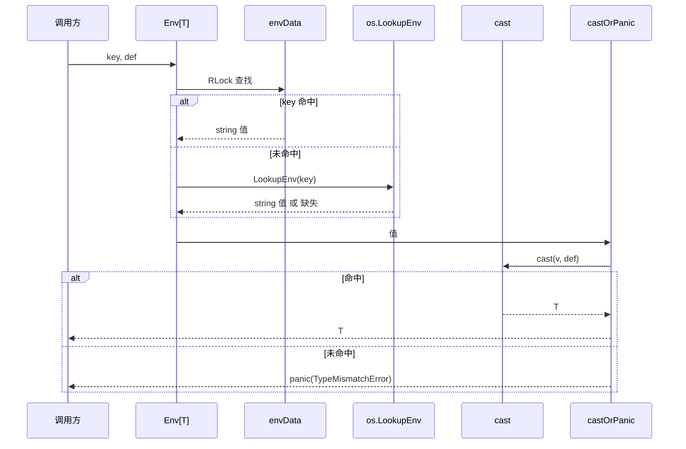

# zcconfig 文档

`zcconfig` 提供两条独立的配置通道（`.env` 文本通道与业务配置树通道）共用一个泛型类型转换引擎，另带一个数据库连接串（DSN）组装工具 `DBConfig`。

本文档集按「先建立模型 → 按任务查契约 → 按需读实现」组织：**使用者**从「5 分钟上手」与各主题的规则表入手；**维护者**读每章的「实现路径」与 [internals.md](internals.md)。

## 30 秒看懂

```mermaid
flowchart LR
    subgraph env["Env 通道"]
        F[".env 文件"] -->|LoadEnv| E[("envData<br/>map[string]string")]
        OS["OS 环境变量"] -. 回退 .-> E
        E -->|Env[T]| C["cast"]
    end
    subgraph cfg["Config 通道"]
        R["Register fn"] -->|mergeMap| G[("configData<br/>map[string]any")]
        G -->|Config[T]| C
    end
    C -->|成功| V["返回 T"]
    C -->|失败| P["panic TypeMismatchError"]
```

- **Env 通道**：`.env` 文件按行解析，值以**原文文本**存入 `envData`；读取时 `Env[T]` 把文本解析成 `T`。OS 环境变量只在 key 不在 `envData` 时参与。
- **Config 通道**：`Register` 把 `fn()` 返回的 `map[string]any` 按 `.` 路径深度合并进 `configData`；`Config[T]` 按路径逐层查找后交给同一个 `cast`。
- **共用引擎**：`cast` 按固定优先级（10 步，见 [cast.md](cast.md)）判定能否转换；key 不存在返回默认值，key 存在但转换失败一律 panic。

## 5 分钟上手

**读 `.env`**（完整示例，编译级校验）：

```go
package main

import (
	"fmt"
	"time"

	"github.com/buexplain/zckg/zcconfig"
)

func main() {
	if err := zcconfig.LoadEnv(".env"); err != nil {
		panic(err)
	}

	port := zcconfig.Env("PORT", 8080)              // int
	debug := zcconfig.Env("DEBUG", false)           // bool
	name := zcconfig.Env("APP_NAME", "zcconfig")    // string（.env 原文）
	timeout := zcconfig.Env("TIMEOUT", 5*time.Second) // time.Duration，.env 中写 30s
	fmt.Println(port, debug, name, timeout)
}
```

配套 `.env`：

```env
APP_NAME="my app"
PORT=8080
DEBUG=true
TIMEOUT=30s
```

**注册并读取业务配置**：见 [config.md](config.md) 的完整示例。

## 概念模型

| 概念 | 实现 | 要点 |
|---|---|---|
| `envData` | `map[string]string` + `sync.RWMutex` | 只存**原文**，装载阶段不做类型推断；nil 不可达 |
| `configData` | `map[string]any` + `sync.RWMutex` | 值可为任意 Go 类型；nil 表示未配置 |
| `cast` | `cast[T any](v any, def T) (T, bool)` | 两条通道共用；`bool=false` 表示未命中 |
| `castOrPanic` | 读取层包装 | nil → 返回 def；未命中 → panic `*TypeMismatchError` |
| `Env` / `Config` | 泛型读取入口 | 查找 + 转换 + 启动期 fail-fast |
| `DBConfig` | 纯函数式 DSN 组装 | 不连接数据库、不注册驱动，只按 Driver 选择格式 |

一次读取的完整调用链：



`Config` 的链路相同，只是把「查 envData / 回退 OS」换成「按 `.` 拆路径、逐层取 `map[string]any`」。

## 设计公理

后续每章都反复引用这五条，它们也是不变量（完整清单见 [conventions.md](conventions.md)）：

1. **类型属于消费点**：值的类型由读取方的 `T` 决定，装载/注册阶段不猜类型（`.env` 因此只存原文）。
2. **键缺失 ≠ 类型不符**：key 不存在（或 Config 路径缺失、值为 nil）返回调用方默认值；key 存在但无法转换必须 panic，不得静默回退。
3. **零拷贝、调用方只读**：`EnvAll` / `ConfigAll` 返回内部 map 的直接引用，只有调试/导出可用。
4. **装载/注册全有或全无**：`LoadEnv` 先解析到局部 map，整文件成功后才合并；`Register` 的 `fn` 先执行完再合并。
5. **启动期 fail-fast**：类型不符用 panic 而不是 error，让配置错误在进程启动时立即暴露。

## 文档地图

| 文档 | 读者 | 内容 |
|---|---|---|
| [env.md](env.md) | 使用 + 维护 | `.env` 解析规则、原文/空值/引号语义、1MB 边界、`Env` 查找顺序 |
| [config.md](config.md) | 使用 + 维护 | `Register` 合并语义、`.` 路径查找、nil 三态、零拷贝 |
| [cast.md](cast.md) | 使用 + 维护 | 10 步判定树、string→T 表、数值安全子集、Duration |
| [db-config.md](db-config.md) | 使用 + 维护 | `DBConfig` 字段语义、三种驱动 DSN 格式与转义 |
| [errors.md](errors.md) | 使用 | panic/error 边界、`TypeMismatchError`、排查表 |
| [internals.md](internals.md) | 维护 | 数据结构、锁、调用链、设计取舍 |
| [conventions.md](conventions.md) | 维护 + 发版 | 不变量、被否决方案、破坏性变更与迁移 |

`zcconfig.md` 为兼容入口（旧链接仍然有效），内容仅指向本文件。

## 术语表

| 术语 | 含义 |
|---|---|
| 装载 / 读取 | 装载 = `.env` 文本进内存（`LoadEnv`）；读取 = 取值并转换（`Env[T]` / `Config[T]`） |
| 原文 | `.env` 中去掉首尾空白与配对引号后的文本，不做数值/布尔归一化（`007` 仍是 `"007"`） |
| 类型不符 | key 存在，但值无法转换为目标 `T`；结果统一为 panic |
| 具名类型 | `type Port int` 这类带名字的底层类型；转换按底层 kind/位宽判定 |
| 数值族 | 有符号整数、无符号整数、浮点、复数四族；跨族仅在静态无损时允许（如无符号→更宽有符号），其余拒绝（见 [cast.md](cast.md)） |
| 安全子集 | 对源类型任意取值都无损的数值转换集合（见 [cast.md](cast.md)） |
| 平台位宽 | `int`/`uint`/`uintptr` 的位宽随平台变化（64 位平台为 64） |

## 文档维护约定

- **单一事实来源**：转换规则只在 [cast.md](cast.md)，错误模型只在 [errors.md](errors.md)，不变量只在 [conventions.md](conventions.md)；其他文档链接而不复述。
- **实现路径**：每章末尾给「函数级锚点」（`env.go:LoadEnv` 形式，不写行号避免漂移）。
- **证据链**：关键规则附「代码与测试锚点」表；文档中的完整 Go 示例由 `docs_examples_compile_test.go` 编译校验，片段需能作为函数体解析。
