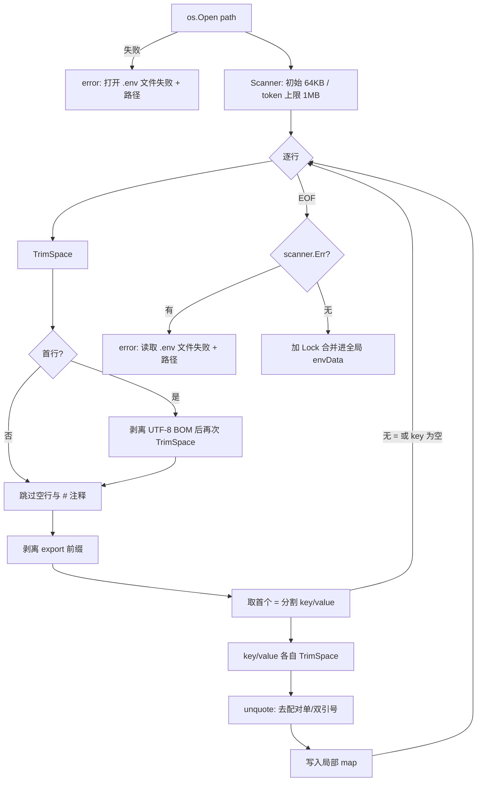

# Env 通道：`.env` 装载与泛型读取

适用范围：`LoadEnv`、`Env`、`EnvAll` 的对外契约与实现原理。转换细节见 [cast.md](cast.md)，错误模型见 [errors.md](errors.md)。

## 数据模型

```text
envData map[string]string   // 值 = .env 原文（去首尾空白与配对引号），零类型推断
envMu   sync.RWMutex        // LoadEnv 写 Lock；Env / EnvAll 读 RLock
```

- 存储值**恒为 string**，因此 `Env` 的 `*TypeMismatchError.Actual` 恒为 `string`，nil 分支对 Env 不可达。
- 不缓存 OS 环境变量：每次 `Env` 未命中 `envData` 时才调用 `os.LookupEnv`。

## 装载：`LoadEnv(path)`



**行解析规则**

| 规则 | 行为 | 备注 |
|---|---|---|
| 空行 / 注释 | `TrimSpace` 后为空或以 `#` 开头 → 跳过 | 缩进的注释同样跳过（因为先 trim） |
| `export` 前缀 | 前 6 字节忽略大小写等于 `export`，且第 7 字节是空格/Tab → 去掉前缀并 `TrimLeft(" \t")` | `exportKEY=v` 是普通 key；仅有 `export` 而无空白不算前缀 |
| 分隔符 | 取**第一个** `=`；没有 `=` 的行静默跳过 | `K=a=b` 的 value 是 `a=b` |
| key | 左侧 `TrimSpace`；空 key（`=value`）静默跳过 | 不做 key 合法性校验 |
| value | 右侧 `TrimSpace`，再去掉**配对**的单/双引号 | 引号不配对则原样保留；引号只影响文本内容 |
| 首行 BOM | 首行先 `TrimSpace`，再剥离 `\uFEFF`，再 `TrimSpace` | 兼容「BOM 前有空白」「BOM 后缩进的 export/注释/空行」 |
| 重复 key | 同一文件内后出现的行覆盖先前的 | 写局部 map 时直接赋值 |
| 空值 | `KEY=` 存为 `""`，**键存在** | 不会删除键，也不会回退默认值/OS（见下） |
| 单行上限 | `bufio.Scanner` 的 token 上限 1MB：单行内容（不含换行符）≥ 1MB 即 `bufio.ErrTooLong`，最大可加载 1MB-1 字节 | 与文件是否以换行符结尾无关 |

**原子合并**：解析先写入局部 `map[string]string`，整文件无错后才加锁合并；因此打开失败、读失败、单行超限都不会修改已有数据。

**错误**：返回 `error`，消息前缀为 `打开 .env 文件失败: <path>: ...` 或 `读取 .env 文件失败: <path>: ...`；超长行可用 `errors.Is(err, bufio.ErrTooLong)` 判定。

## 存储语义（`.env` → `envData`）

| 输入 | 存储值 | `Env[string]` | `Env[int]` / 其他 |
|---|---|---|---|
| `PORT=8080` | `"8080"` | `"8080"` | `8080` |
| `NAME="my app"` | `my app` | `my app` | panic（非整型文本） |
| `PAD=007` | `"007"`（不归一化） | `"007"` | `7` |
| `EXP=1e3` | `"1e3"` | `"1e3"` | `float64` → `1000`；`int` → panic |
| `EMPTY=` | `""` | `""`（不是默认值） | panic（key 存在、解析失败） |
| `NOEQUALS` | 不写入 | — | 回退默认值 / OS |
| `=v` | 不写入 | — | 同上 |

> **原文不归一化**：装载阶段不调用 `ParseInt/ParseFloat/ParseBool`，所以 `007`、`1e3`、`1.50`、`TRUE`、`+5` 都按文件里的样子保存；类型解析全部发生在读取时。

## 读取：`Env[T](key, def)`

查找顺序：

1. `envData[key]` 命中 → 直接 `castOrPanic(key, 值, def)`；
2. 未命中 → `os.LookupEnv(key)` 命中 → `castOrPanic(key, 值, def)`；
3. 都未命中 → 返回 `def`。

由于两条来源都是**文本**，同一字面量的转换结果与失败边界完全一致（不存在「.env 里是 int、OS 里是 string」的分裂）。

**读取结果二分**

| 情况 | 结果 |
|---|---|
| key 不存在（两处都没有） | 返回 `def` |
| key 存在、目标为 `string` / 具名 `string` | 恒成功，返回文本原值（`.env` 原文或 OS 变量值） |
| key 存在、文本无法解析为 `T` | panic `*TypeMismatchError`（`Expected=T`、`Actual=string`） |
| key 存在、目标为接口类型且文本未实现该接口 | panic（接口目标只接受直接类型断言） |

**空值与 OS 回退**：`.env` 中 `KEY=` 属于「key 存在」，因此 `Env` 直接返回 `""` 或按解析失败 panic，**不会**再回退 OS 环境变量。

## `EnvAll()`

返回 `envData` 的直接引用（`map[string]string`，零拷贝），**不含** OS 环境变量。仅限只读：任何写入都会污染全局配置，并与并发 `Env` / `LoadEnv` 产生数据竞争。详见 [internals.md](internals.md) 的零拷贝取舍。

## 实现路径

| 行为 | 实现 |
|---|---|
| 打开与错误包装 | `env.go:LoadEnv` |
| 逐行解析、BOM、export、跳过规则 | `env.go:LoadEnv` |
| 去引号 | `env.go:unquote` |
| 原子合并 + 锁 | `env.go:LoadEnv` |
| 查找顺序（envData → OS → def） | `env.go:Env` |
| 零拷贝导出 | `env.go:EnvAll` |
| 转换与 panic | `cast.go:cast`、`cast.go:castOrPanic` |

## 代码与测试锚点

| 能力 | 测试 |
|---|---|
| 基础解析（引号/空值/export/无引号/默认值） | `TestLoadEnv_BasicTypes` |
| export 前缀变体 | `TestLoadEnv_ExportPrefixVariants` |
| 多文件合并、后加载覆盖 | `TestLoadEnv_MergeMultipleFiles` |
| 无 `=`/空 key 行跳过 | `TestLoadEnv_SkipsInvalidLines` |
| 首行 BOM 与 BOM 前空白 | `TestLoadEnv_Utf8Bom`、`TestLoadEnv_BOMIndentedFirstLine` |
| 超长行与 1MB 精确边界（含无换行文件） | `TestLoadEnv_LineTooLong`、`TestLoadEnv_LineLimitBoundary` |
| 打开失败/错误含路径 | `TestLoadEnv_FileNotFound` |
| 失败不污染已有数据 | `TestLoadEnv_FailureDoesNotPollute` |
| 原文保留（007/1e3/1.50/TRUE/+5） | `TestEnv_RawTextPreserved` |
| EnvAll 内容与类型 | `TestEnvAll` |
| OS 回退与宽松转换 | `TestEnv_OsEnvFallback`、`TestEnv_OsEnvFallbackConversion` |
| 具名 string / 具名 bool | `TestEnv_NamedStringConversion`、`TestEnv_NamedBoolConversion` |
| Duration 必须带单位 | `TestEnv_DurationUnits` |
| 接口目标 panic | `TestEnv_NilInterfaceDefKeyExistsPanics` |

相关章节：[cast.md](cast.md)（文本→T 的完整规则）、[errors.md](errors.md)（panic 载荷与排查）。
