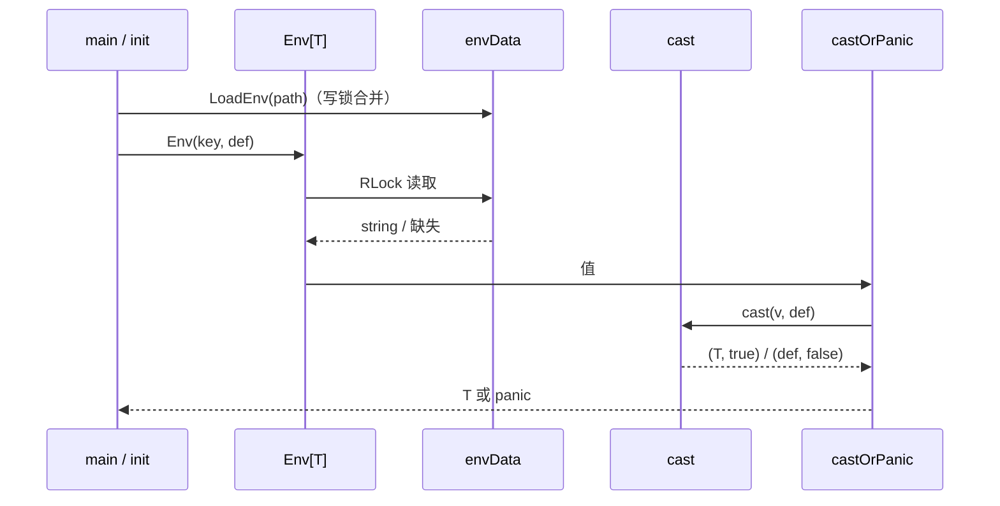

# 实现原理

本文档面向维护者：讲清 zcconfig 的数据结构、锁、调用链与关键设计取舍。使用契约见 [env.md](env.md)、[config.md](config.md)、[cast.md](cast.md)。

## 数据结构

| 存储 | 类型 | 保护 | 生命周期 |
|---|---|---|---|
| `envData` | `map[string]string` | `envMu sync.RWMutex` | 进程级全局；`LoadEnv` 合并，测试用 `reset` 清空 |
| `configData` | `map[string]any` | `configMu sync.RWMutex` | 进程级全局；`Register` 合并，测试用 `reset` 清空 |

两条通道**完全独立**：各自一把锁、各自一个 map，互不影响；只有 `cast` 是共享的纯函数。

## 调用链

`Config` 链路相同，差异只在「取值」阶段：按 `.` 拆路径逐层取 `map[string]any`，并对 nil/非 map 做二分（见 [config.md](config.md)）。

## 装载/注册的原子性

- `LoadEnv`：先 `os.Open`，逐行写入**局部** `map[string]string`；只有 `scanner.Err() == nil` 时才加写锁合并。失败（打不开、读错误、单行超限）不修改 `envData`。
- `Register`：先调用 `fn()`（**不持锁**，避免用户代码阻塞读者），拿到 map 后再加写锁做 `ensureMapAt` + `mergeMap`。
- `mergeMap` 递归合并是原地修改：`configData` 的根 map 与已存在的子 map 引用保持不变（零拷贝约定的基础）。

## 零拷贝：为什么不做拷贝

`ConfigAll()` / `EnvAll()` 返回内部 map 的直接引用，模块**不提供**任何浅拷贝/深拷贝方案：

- `map[string]any` 的 value 可以是 slice、指针、chan、func、嵌套 map——任何部分拷贝都无法真正隔离，反而制造「我已经拷贝了」的虚假安全感。
- 拷贝需要额外内存与锁窗口，且与「启动期注册、运行期只读」的约定矛盾。
- 因此约定是**调用方只读**：返回值的写操作会污染全局配置，并与 `Register`/`LoadEnv` 并发读取产生数据竞争（`go test -race` 可复现）。

## panic 策略

配置错误用 panic 而不是 error：

- 配置在启动阶段加载，错误应立即终止启动；返回 error 会迫使每个调用点写错误处理，而绝大多数调用点没有有意义的恢复动作。
- `LoadEnv` 的 I/O 错误仍返回 error（可恢复/可重试），与类型错误（配置写错，不可恢复）区分。
- `TypeMismatchError` 提供 `Key/Expected/Actual`，调用方可在最外层 recover 并打印后重新 panic。

详见 [errors.md](errors.md)。

## 启动期约定（约定而非机制）

文档与注释中的「`Register` / `LoadEnv` 仅允许启动阶段调用」是**调用方契约**，实现没有强制限制：

- 两个写入入口都有写锁，机械上可以在运行期调用；
- 但运行期合并会与 `EnvAll`/`ConfigAll` 返回的零拷贝引用产生竞争，因此不建议；
- 并发测试（`TestConcurrent_LoadEnvAndEnv`、`TestConcurrent_RegisterAndConfig`）只验证锁的正确性，不代表支持运行期热更新。

## `reset` 仅测试

`reset()`（未导出）同时清空 `envData` 与 `configData` 并替换为新 map；它只服务测试隔离，不属于公开契约。

## 性能特征

| 操作 | 复杂度 / 开销 |
|---|---|
| `LoadEnv` | 每行 `TrimSpace` + 首个 `=` 查找 + 可选去引号；无正则、无类型解析 |
| `Env[T]` | 一次 map 查找 + `cast` 判定；未命中再来一次 `os.LookupEnv` |
| `Config[T]` | 按段数 d 做 d 次 map 查找 + `cast` |
| 零拷贝访问 | `ConfigAll`/`EnvAll` 仅取锁后返回引用，无分配 |

## 实现路径

| 行为 | 实现 |
|---|---|
| Env 存储、锁、原子合并 | `env.go:LoadEnv`、`env.go:Env`、`env.go:EnvAll` |
| Config 存储、锁、合并、路径读取 | `config.go:Register`、`config.go:ensureMapAt`、`config.go:mergeMap`、`config.go:Config`、`config.go:ConfigAll` |
| 转换与 panic | `cast.go:cast`、`cast.go:castOrPanic` |
| 测试状态重置 | `config.go:reset` |

## 代码与测试锚点

| 能力 | 测试 |
|---|---|
| LoadEnv 并发读写无数据竞争 | `TestConcurrent_LoadEnvAndEnv`（需 `-race`） |
| Register/Config 并发 | `TestConcurrent_RegisterAndConfig`（需 `-race`） |
| 零拷贝引用 | `TestConfigAll_ZeroCopy`、`TestEnvAll` |
| 合并原地修改（引用保持） | `TestRegister_MapMergeBoundaries` |
| reset | `TestReset_ThenRead` |
| 加载失败不污染 | `TestLoadEnv_FailureDoesNotPollute` |

相关章节：[conventions.md](conventions.md)（不变量与被否决方案）。
