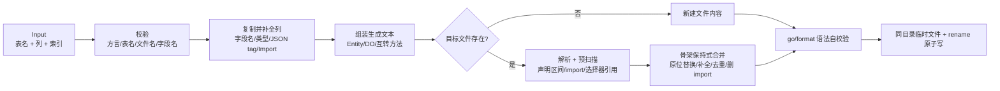

# zcmodel 文档

`zcmodel` 是一个**数据库模型代码生成器**：输入一张表的结构（表名、列名、列类型、注释、索引），输出一个可直接编译的 Go 文件，内含 Entity 结构体、DO 结构体与两者的互转方法；对已存在的生成文件采用「骨架保持式合并」再生成，保留用户手写代码与注释。

本文档集按「先建立模型 → 按任务查契约 → 按需读实现」组织：**使用者**从 [快速开始](quickstart.md) 与各主题的规则表入手；**维护者**读每章末尾的「实现/测试」锚点、[架构](architecture.md)、[生成流水线](pipeline.md) 与 [骨架保持式合并](skeleton-merge.md)。

## 30 秒看懂



- **产物**：`package` + 必要 import + `XxxEntity`（具体类型字段）+ `ToDO` + `XxxDO`（`any` 字段）+ `ToEntity`；不写 `// Code generated` 标记（文件含用户代码，需保留静态检查）。
- **再生成**：以原文件顶层声明序列为骨架，生成声明原位替换、用户声明与注释原位保留、import 按引用增删；整个产物最终经 gofmt。
- **字段元数据**：`ddl` tag 呈现类 DDL 列定义片段、`primary_key` 标记主键、`Indexes` 渲染为结构体 doc 注释中的索引块；这些都是**生成时刻的快照**。
- **纯代码生成**：不连接数据库、不依赖数据库驱动；表结构可手工构造，也可经 [zcdb Schema](../../zcdb/docs/reference/schema.md) 从真实数据库读取。

## 核心概念

| 概念 | 含义 |
|---|---|
| Entity / DO | Entity 字段是具体 Go 类型（读模型）；DO 字段全是 `any`（写模型，可区分“未赋值”与零值） |
| 生成声明 | 由生成器负责的四个顶层声明：Entity 结构体、`ToDO`、DO 结构体、`ToEntity` |
| 骨架 | 原文件的顶层元素序列（文件头、package 行、import、各声明、文件尾注释） |
| 骨架保持式合并 | 生成声明原位替换、用户声明原位保留的再生成算法，见 [skeleton-merge.md](skeleton-merge.md) |
| 元数据快照 | `ddl`/`primary_key`/索引块来自生成时传入的元数据，表结构变化后需重新生成 |

完整术语见 [术语与不变量](glossary.md)。

## 文档地图

| 文档 | 回答什么问题 | 主要读者 |
|---|---|---|
| [快速开始](quickstart.md) | 怎么跑通一次生成？产物长什么样？怎么接 zcdb Schema？ | 首次接入 |
| [对外 API](api.md) | `Input` 每个字段什么含义？会返回哪些错误？ | 使用者 |
| [生成代码契约](generated-code.md) | 产物有哪些结构、tag、方法、包名保证？ | 使用者 |
| [字段、tag 与 ddl](tags-ddl-index.md) | 一行字段的 tag 为什么长这样？ddl 片段和索引块怎么生成？ | 使用者 |
| [类型映射与命名转换](types-and-naming.md) | 列类型如何映射？`user_id` 如何变 `UserID`？ | 使用者 |
| [增量再生成](regeneration.md) | 再生成会替换什么、保留什么？有哪些边界？ | 使用者 |
| [架构](architecture.md) | 代码由哪些文件/函数组成？为什么这样设计？ | 维护者 |
| [生成流水线](pipeline.md) | `Generate` 分几个阶段？失败时有什么副作用？ | 维护者 |
| [骨架保持式合并](skeleton-merge.md) | 槽位/落点/import/注释的具体算法是什么？ | 维护者 |
| [测试与排障](testing.md) | 测试怎么分层？如何复现与定位回归？ | 维护者 |
| [术语与不变量](glossary.md) | 术语定义与必须保持的行为不变量 | 所有人 |
| [代码地图](code-map.md) | 文档章节 ↔ 源码符号 ↔ 锁死测试 | 维护者 |
| [zcmodel.md](zcmodel.md) | 兼容入口（旧链接可用） | — |

## 阅读路径

- **第一次用**：[快速开始](quickstart.md) → [对外 API](api.md) → 遇到具体字段/类型问题查 [字段、tag 与 ddl](tags-ddl-index.md) 与 [类型映射与命名转换](types-and-naming.md)。
- **要理解再生成**：[增量再生成](regeneration.md)（契约与例子）→ [骨架保持式合并](skeleton-merge.md)（算法）。
- **要改实现/排障**：[架构](architecture.md) → [生成流水线](pipeline.md) → [骨架保持式合并](skeleton-merge.md) → [测试与排障](testing.md) → [代码地图](code-map.md)。

## 最短示例

```go
func generateUserModel() error {
	return zcmodel.Generate(zcmodel.Input{
		OutputDir: "./model",
		Dialect:   zcmodel.DialectMysql,
		TableName: "user",
		Columns:   []*zcmodel.Column{{Name: "id", Type: "bigint"}},
	})
}
```

生成 `./model/user.go`，包含 `UserEntity`、`UserDO` 与 `ToDO`/`ToEntity`。可运行版本、逐项解释与真实产物见 [快速开始](quickstart.md)。

## 与 zcdb 的关系

- `zcmodel` 不依赖 zcdb；`zcdb` 也不依赖 zcmodel。
- 推荐组合：用 zcdb 的 `SchemaInspector` 读取 `ColumnInfo`/`IndexInfo`，桥接成 `zcmodel.Column`/`zcmodel.IndexInfo` 后调用 `Generate`。桥接代码见 [快速开始](quickstart.md#4-配合-zcdb-schema-从真实数据库生成)。
- 列映射 tag（`ColumnTagName`）与 zcdb 的映射标签对应；两边都按 struct tag 的值匹配真实列名。

## 文档约定

- 文档中的 `go` 代码块应保持可被 `gofmt -e` 解析；整文件示例由 `docs_examples_compile_test.go` 做编译级核对。
- 代码引用使用**符号名**（如 `build.go` `writeOrReplaceStruct`），不写易漂移的行号；章节末尾的「实现/测试」给出源码符号与锁死测试名，完整对照见 [代码地图](code-map.md)。
- 发现文档与实现不一致时：先按 [测试与排障](testing.md) 复现，再同步代码/注释/文档/测试四处。
