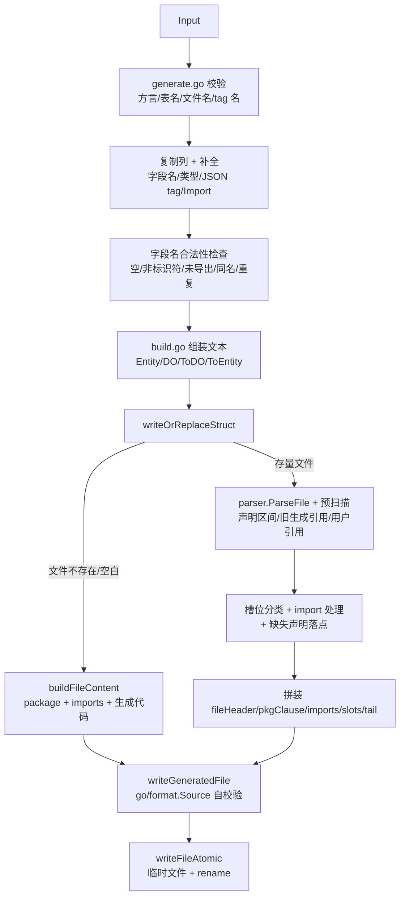

# 架构

> 返回 [zcmodel 文档地图](zcmodel.md)。本文回答：代码由哪些文件与函数组成、数据怎么流动、为什么这样设计。算法细节见 [骨架保持式合并](skeleton-merge.md)，阶段与失败副作用见 [生成流水线](pipeline.md)。

## 定位与约束

- **纯代码生成**：不连接数据库、不引入数据库驱动，依赖仅标准库（`go/ast`、`go/parser`、`go/format`、`go/token`、`go/build` 等）。
- **单一入口**：生成行为全部经 `Generate(Input) error`；其余导出符号只有命名转换工具（`SplitWords`、`ToPascalCase` 与六个风格函数）与枚举/类型。
- **输入即全部信息**：表结构、列注释、索引、可空性、默认值都由调用方提供；zcdb 桥接是可选的调用方代码，不在本包依赖内。
- **产物可编译、可 gofmt**：落盘前强制语法自校验；生成声明与用户代码共存于同一文件。

## 文件职责

| 文件 | 职责 | 关键符号 |
|---|---|---|
| `input.go` | 对外数据结构与枚举 | `Input`、`Column`、`StructFieldInfo`、`IndexInfo`、`NameCase`、`Dialect` |
| `generate.go` | 入口、输入校验、列补全、字段名校验、输出路径与写文件调用 | `Generate`、`validateTableName`、`resolveFileName`、`goFileNameConflict`、`validateColumnTagName`、`isPathWithinDir`、`neededImportsOf` |
| `build.go` | 代码文本组装 + 骨架保持式合并 + 原子写 | `buildStruct`、`assembleDDLFragment`、`buildIndexCommentBlock`、`formatStructTag`、`writeOrReplaceStruct`、`splitGeneratedCode`、`structSpecText`、`writeGeneratedFile`、`writeFileAtomic` |
| `toCase.go` | 命名风格转换 | `SplitWords`、`ToPascalCase`、`ToLowerCamel` 等六个风格函数、`formatJSONTag`、`lowerFirst` |
| `columnTypeToGoType.go` | 列类型归一化与方言映射 | `normalizeColumnType`、`makeColumnTypeToGoTypeMap`、`formatStructFieldType` |
| `*_test.go` | 单元、golden、编译级、集成、fuzz | 见 [测试与排障](testing.md) |

## 数据流

## 调用链（按执行顺序）

1. `Generate`：校验方言 → `validateTableName` → `ToPascalCase` 校验结构体名前缀 → `resolveFileName`（含 `goFileNameConflict`）→ `validateColumnTagName`。
2. 复制 `Columns`（nil 报错），补全 `JsonTagValue`/`StructFieldInfo.Name`/`StructFieldInfo.Type`/`Import`，然后做字段名五项检查。
3. `buildStruct`（Entity、DO）与 `buildToDOMethod`/`buildToEntityMethod` 生成四段文本；`neededImportsOf` 汇总 import。
4. `os.MkdirAll` + `isPathWithinDir` 防逃逸，调用 `writeOrReplaceStruct`。
5. `splitGeneratedCode` 把生成文本拆成结构体段/方法段；`structSpecText` 生成块内 Spec 形态。
6. 存量文件：`parser.ParseFile` → 预扫描（`declStarts`、`lineCommentEnd`、`skipDeclSeparators`、`collectSelectorRefs`）→ 逐槽位分类（import / type 块 / 生成方法 / 用户声明）→ import 增删 → 缺失声明落点 → 拼装。
7. `writeGeneratedFile` 执行 `go/format.Source` 自校验并格式化；`writeFileAtomic` 临时文件 + rename 落盘，保留权限位。

## 设计取舍

- **不写 `// Code generated ... DO NOT EDIT.`**：官方标记会让 staticcheck、golangci-lint 等**整体跳过**该文件，而产物中含有用户手写代码；生成区/用户区的契约由合并算法保证，不靠文件头声明。
- **骨架保持式合并，而不是把 AST 整体重印**：`go/printer` 重印会丢声明间的游离注释、`//go:generate` 指令与原始排列；本实现按源码偏移切片、只替换生成声明区间，用户代码文本与位置不动（最终统一 gofmt）。
- **生成声明按名字识别**：Entity/DO 类型名与 `ToDO`/`ToEntity` 方法名是唯一标识；同名的用户类型会被当作生成声明替换（文档明确警告），换来实现简单、可预测。
- **冲突与非法输入直接报错**：字段名冲突、import 本地名冲突、表名/文件名非法、存量文件解析失败都返回错误且不落盘，而不是“尽力生成一个可能不可编译的文件”。
- **tag 值统一转义**：所有 tag 值先 `strconv.Quote`；任一键/值含反引号时整个 tag 改用解释型字符串字面量，从而完整保留真实列名（含反引号），避免列映射失配。
- **`ddl` 是重组的类 DDL 文本**：目标是让人/AI 读懂列定义，不承诺可直接执行；因此保留方言原样的类型/默认值形态，并明确列出已知歧义。
- **包名由输出目录推导（仅新建）**：零配置得到可编译包；存量文件尊重原 `package` 声明，避免把用户文件改包名。
- **元数据快照**：生成器不回查数据库，`ddl`/`primary_key`/索引块都可能过期；刷新方式是重新调用 `Generate`。

## 依赖边界

| 方向 | 说明 |
|---|---|
| zcmodel → zcdb | **无**。zcmodel 只消费 `Input`；`zcdb` 的 Schema 读取需要调用方自己桥接 |
| zcdb → zcmodel | 无 |
| zcmodel → 标准库 | `go/ast`、`go/parser`、`go/format`、`go/token`、`go/build`、`strconv`、`unicode` 等 |

## 代码地图

文档章节 ↔ 源码符号 ↔ 锁死测试的完整对照表见 [代码地图](code-map.md)。
